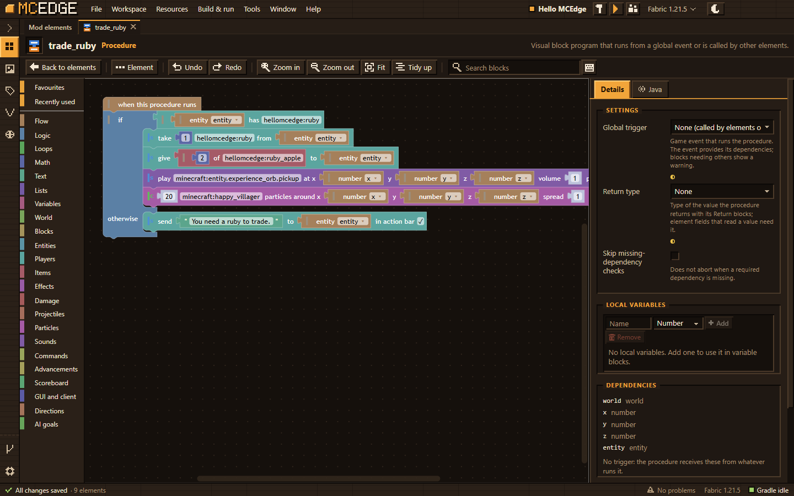
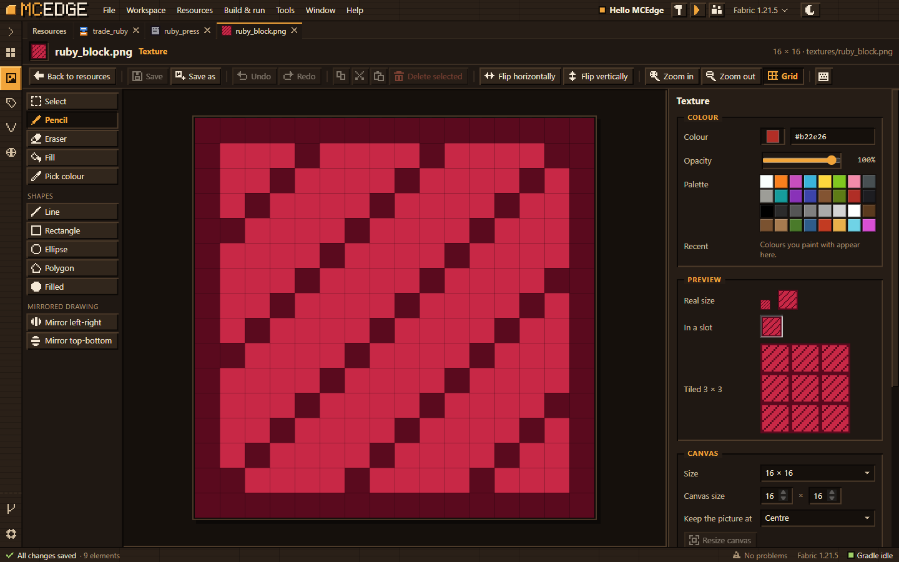
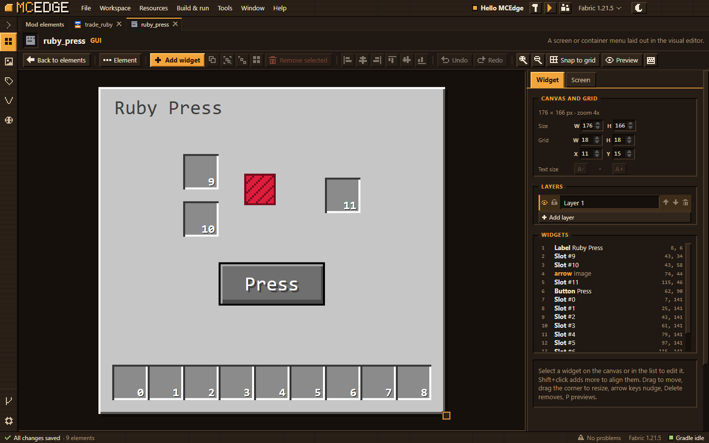
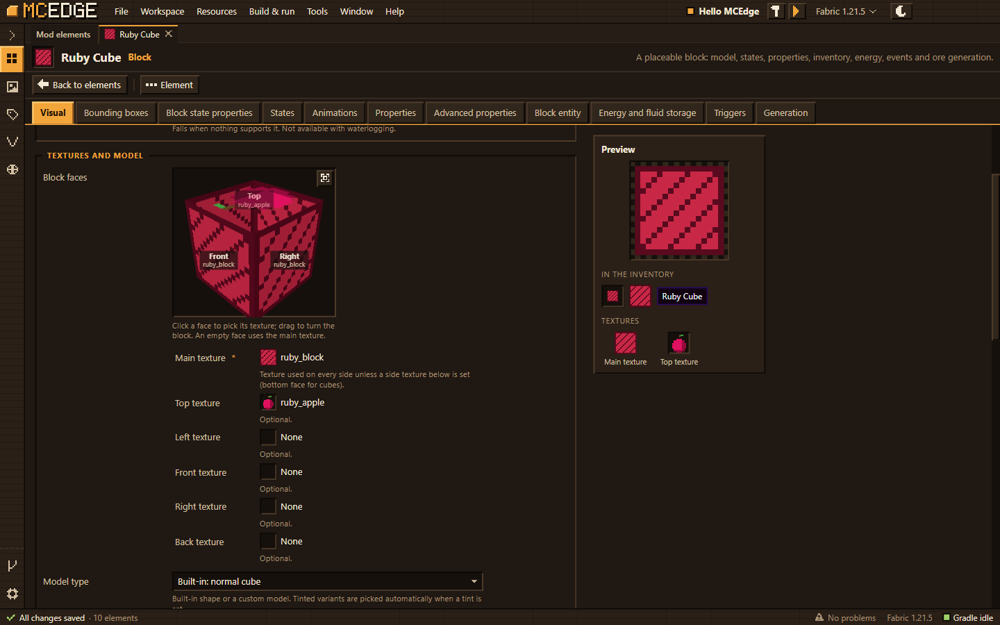
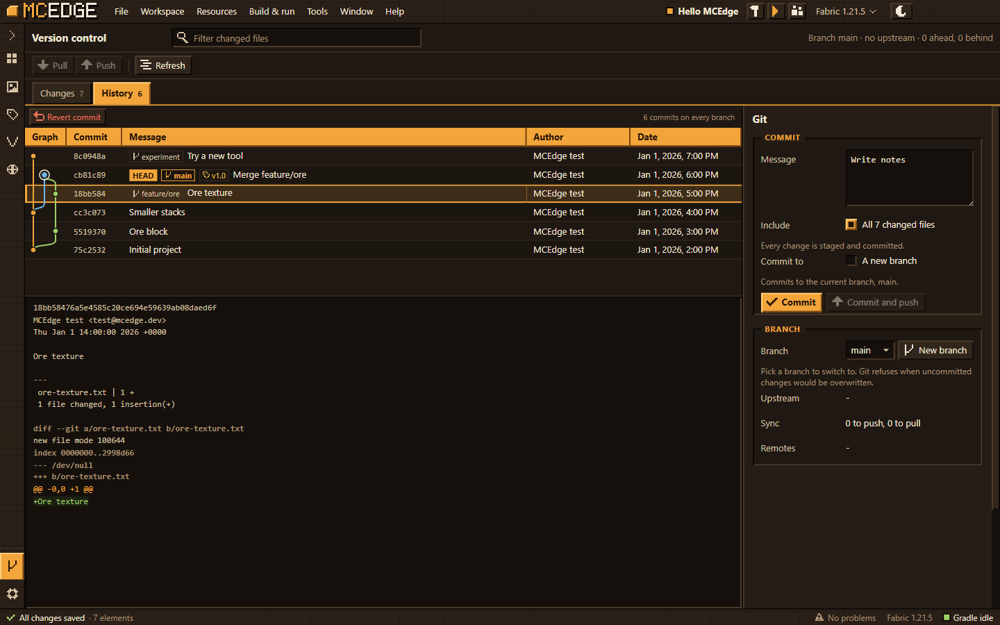
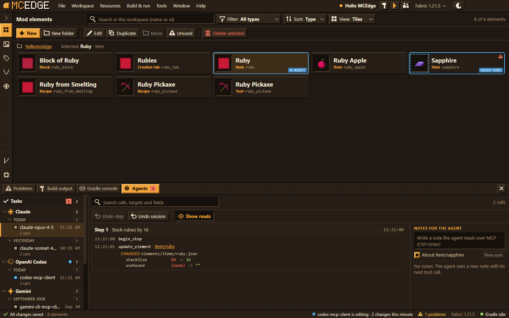

# MCEdge

[English](README.md) | [Türkçe](README.tr.md) | **Deutsch** | [Español](README.es.md) | [简体中文](README.zh-CN.md)

MCEdge ist ein Desktop-Editor, mit dem du Minecraft-Mods ohne Java-Code erstellst, ähnlich wie MCreator. Du
beschreibst deinen Mod als Elemente (Items, Blöcke, Werkzeuge, GUIs, Entities, Rezepte...) und als blockbasierte
Prozeduren; MCEdge erzeugt und baut daraus denselben Mod für fünf Spielversionen und Loader: Forge, NeoForge und
Fabric. Ein Projekt ist ein gewöhnlicher Ordner mit JSON-Dateien und Texturen und passt daher gut zu Git.
KI-Coding-Agenten können es über einen eingebauten MCP-Server live lesen und bearbeiten.

## Screenshots

| | |
| --- | --- |
|  |  |
| Prozeduren werden aus Blöcken gebaut und für jede Engine zu Java kompiliert. | Pixel-Textur-Editor mit Formen, Spiegeln, Vorschau und Animationsframes. |
|  |  |
| Visueller Layout-Editor für GUIs und HUD-Overlays. | Blocktexturen auf einem 3D-Würfel: Klick auf eine Seite wählt ihre Textur. |
|  |  |
| Versionskontrolle mit Branch-Graph, Commit, Branches, Pull und Push. | Elementliste und Agenten-Panel: was jeder KI-Agent Schritt für Schritt geändert hat, mit Rückgängig. |

## Funktionen

**Mod-Elemente**

- 37 Elementtypen: Item, Block, Werkzeug, Rüstung, Rezept, Kreativ-Tab, Loot-Tabelle, GUI, Overlay, Prozedur,
  Befehl, lebende Entity, Projektil, Flüssigkeit, Pflanze, Verzauberung, Trankeffekt, Partikel, Gemälde, Biom,
  Struktur, Dimension, Dorfbewohner-Beruf und -Handel, Spielregel, Tastenbelegung, Fortschritt und mehr.
- Formulare mit Hilfetexten, Live-Vorschau und Prüfung pro Feld; ein Problems-Panel mit Schweregraden und
  Ignorier-Regeln.
- Ordner, Suche, Filter, Verwendungen finden, Umbenennen mit Aktualisierung aller Verweise, ungenutzte Elemente
  finden, Vorlagen und "Create pack" (Erz-, Werkzeug-, Rüstungs-, Holz- oder Material-Sets aus einem Namen und einer
  Farbe).
- Element-Tags, globale Variablen und Sound-Events.

**Prozeduren**

- Blockly-Editor mit rund 430 Blöcken in Kategorien (Ablauf, Logik, Mathematik, Welt, Entities, Spieler, Items,
  Effekte, Partikel, Sounds, GUI und Client, KI-Ziele...).
- Globale Trigger (Spielereignisse), Client- und Serverseite mit erzeugten Paketen, Rückgabewerte und lokale
  Variablen.
- Der erzeugte Java-Code einer Prozedur wird neben ihren Blöcken angezeigt.

**Ressourcen**

- Textur-Editor: Stift, Füllen, Formen, Auswahl, gespiegeltes Zeichnen, Farbton und Entsättigen, Leinwandgröße,
  Animationsframes (`.mcmeta`) und Live-Vorschau im Slot und gekachelt.
- 3D-Vorschau von Block- und Item-Modellen; Blockseiten auf einem Würfel; Blockbench-Anbindung für JSON-Modelle.
- Layout-Editor für GUIs und Overlays mit Ebenen, Raster, Ausrichten und Vorschau.
- Import von Texturen, Sounds, Modellen und Strukturen.

**Bauen und starten**

- Ein Projekt, fünf Engines (siehe unten). JDK und Gradle jeder Engine werden bei der ersten Nutzung
  heruntergeladen.
- Eine Engine oder alle bauen, Client und dedizierten Server starten, mehrere Clients mit verschiedenen
  Spielernamen für Multiplayer-Tests, Debug-Client.
- Build-Fehler im erzeugten Code verweisen auf das Element, das sie verursacht hat.
- Mod-Jars für die gewählten Engines exportieren; den ganzen Workspace als Zip exportieren.
- Abhängigkeiten von Modrinth, CurseForge oder Maven werden für Testläufe heruntergeladen.
- Gesperrter erzeugter Code: Handänderungen am erzeugten Java eines Elements bleiben beim Neuerzeugen erhalten.

**Projektwerkzeuge**

- Lokalisierung: alle Sprachen nebeneinander, fehlende Texte, Import und Export als CSV und Lang-JSON.
- Versionskontrolle: Änderungen, Commit, Branches, Verlauf mit Branch-Graph, Revert, Pull und Push (nutzt dein Git).
- Code-Projekt-Modus: einen gewöhnlichen Gradle-Mod öffnen und seine Dateien im Monaco-Editor bearbeiten.
- Oberfläche auf Englisch und Türkisch, dunkles und helles Theme.

**KI-Agenten (MCP)**

- Ein Model-Context-Protocol-Server mit 144 Tools deckt ab, was die App kann: Elemente, Prozeduren, Texturen,
  GUI-Layouts, Lokalisierung, Tags, Builds, Client- und Serverläufe, Logs, Screenshots des Spielfensters, Git.
- Live-Co-Editing: du und der Agent arbeitet gleichzeitig am selben Projekt; offene Editoren übernehmen die
  Änderungen des Agenten Feld für Feld.
- Das Agenten-Panel listet Sitzungen pro Agent (Claude, Codex, Gemini und andere), zeigt jeden Schritt mit Diff auf
  Feldebene und macht einen Schritt oder eine ganze Sitzung rückgängig. Aus der App kannst du dem Agenten Notizen
  und Aufgaben hinterlassen.

## Unterstützte Engines

| Engine | Loader | Minecraft | Mod-Java | Gradle (läuft auf JDK) |
| --- | --- | --- | --- | --- |
| `forge-1.16.5` | Forge 36.2.39 | 1.16.5 | 8 | 7.6.4 (JDK 8) |
| `neoforge-1.21.5` | NeoForge 21.5.101 | 1.21.5 | 21 | 9.8.2 (JDK 25) |
| `neoforge-26.3` | NeoForge 26.3.0.99 | 26.3 | 25 | 9.8.2 (JDK 25) |
| `fabric-1.21.5` | Fabric Loader 0.20.1, Fabric API 0.128.2 | 1.21.5 | 21 | 9.8.2 (JDK 25) |
| `fabric-26.3` | Fabric Loader 0.20.1, Fabric API 0.165.0 | 26.3 | 25 | 9.8.2 (JDK 25) |

Die Engines sind in [`engines/`](engines) definiert. Kann eine Engine ein Feld, einen Block oder einen Trigger nicht
erzeugen, zeigt die App das an (die Elementliste kann nach Elementen filtern, die eine Engine nicht erzeugt).

## Download und Installation

MCEdge läuft unter Windows (x64). Lade es von
[GitHub Releases](https://github.com/SalihEfeTosunBayraktar/MCEdge/releases) herunter:

- `MCEdge-Setup-<version>.exe` installiert MCEdge für deinen Benutzer (Ordner wählbar) und aktualisiert sich über
  GitHub Releases selbst.
- `MCEdge-Portable-<version>.exe` läuft ohne Installation. Es aktualisiert sich nicht selbst, meldet aber neue
  Versionen.

Der erste Build oder Start einer Engine lädt deren JDK (Eclipse Temurin von Adoptium) und Gradle nach
`%APPDATA%\MCEdge\toolchains`; danach lädt Gradle Minecraft und den Loader. Das dauert einmal pro Engine ein paar
Minuten und braucht eine Internetverbindung. Für die Versionskontrolle muss [Git](https://git-scm.com/) im `PATH`
sein.

## Schnellstart

1. MCEdge starten und **File > Open example project** wählen (Hello MCEdge: Rubin-Item, Block, Spitzhacke, Rezepte
   und ein Kreativ-Tab) oder **File > New project...**.
2. Ein Element per Doppelklick bearbeiten oder mit **New** ein neues anlegen.
3. Oben rechts eine Engine wählen, dann **Build & run > Run client** (F5), um Minecraft mit deinem Mod zu starten.
4. **File > Export mod jar...** (Ctrl+E) schreibt die Jars der gewählten Engines.

Die Anleitung öffnet sich über **Help > User guide...** ([docs/guide/en](docs/guide/en), Englisch und Türkisch).

## KI-Agenten über MCP

Der MCP-Server arbeitet auf einem Projektordner und spricht über stdio; dein KI-Client startet ihn. Er kommt mit der
installierten App, auf dem Rechner des Agenten braucht es weder Node.js noch einen Quellcode-Checkout: Der Client
startet `MCEdge.exe` als Node (`ELECTRON_RUN_AS_NODE=1`) mit dem in der App gebündelten Server, ohne Fenster.
**Help > Connect an AI agent** (auch *Connect an agent* im Agenten-Panel) zeigt den genauen Befehl für deine
Installation und das offene Projekt, mit fertigen Einstellungen zum Kopieren für Claude Code, Codex, Gemini CLI,
Cursor und andere Clients.

Bei der Standardinstallation pro Benutzer, für Claude Code:

```
claude mcp add --transport stdio --env ELECTRON_RUN_AS_NODE=1 mcedge -- "C:\Users\you\AppData\Local\Programs\MCEdge\MCEdge.exe" "C:\Users\you\AppData\Local\Programs\MCEdge\resources\app.asar\out\cli\index.js" mcp "C:\mods\my-mod"
```

Clients mit JSON-Konfiguration (Gemini CLI `~/.gemini/settings.json`, Cursor `.cursor/mcp.json`, Claude Desktop und
andere) nehmen denselben Befehl; Codex nimmt ihn als `[mcp_servers.mcedge]` in `~/.codex/config.toml`:

```json
{
  "mcpServers": {
    "mcedge": {
      "command": "C:\\Users\\you\\AppData\\Local\\Programs\\MCEdge\\MCEdge.exe",
      "args": ["C:\\Users\\you\\AppData\\Local\\Programs\\MCEdge\\resources\\app.asar\\out\\cli\\index.js", "mcp", "C:\\mods\\my-mod"],
      "env": { "ELECTRON_RUN_AS_NODE": "1" }
    }
  }
}
```

Die portable Exe kann keine Agenten bedienen (sie entpackt sich in einen temporären Ordner, der beim Schließen
gelöscht wird); installiere MCEdge für MCP mit dem Installer.

Aus einem Quellcode-Checkout (siehe [Aus dem Quellcode bauen](#aus-dem-quellcode-bauen); `npm install` genügt) läuft
derselbe Server mit Node.js:

```
node <MCEdge-Checkout>/src/cli.ts mcp <Projektordner>
claude mcp add mcedge -- node C:/src/MCEdge/src/cli.ts mcp C:/mods/my-mod
```

Lass das Projekt in MCEdge offen, um die Arbeit des Agenten im Agenten-Panel zu verfolgen. Alle Tools stehen in
[docs/MCP.md](docs/MCP.md). Ein gewöhnlicher Gradle-Mod-Ordner funktioniert auch, mit den Datei-, Build-, Start- und
Git-Tools.

## Aus dem Quellcode bauen

Voraussetzungen: Windows, [Node.js](https://nodejs.org/) 24 (der Kern führt seine TypeScript-Quellen direkt aus) und
Git.

```
git clone https://github.com/SalihEfeTosunBayraktar/MCEdge.git
cd MCEdge
npm install
npm run dev          # App mit Hot Reload
npm run build:app    # Build nach out/; npm start startet die gebaute App
npm run dist         # Windows-Installer und portable Exe nach release/
npm run typecheck
```

Die Kommandozeile baut ein Projekt ohne die App:

```
node src/cli.ts build examples/hello --target fabric-1.21.5   # oder --target all, --no-gradle nur zum Erzeugen
node src/cli.ts engines
```

## Projektstruktur

| Pfad | Inhalt |
| --- | --- |
| `app/` | Electron-App: Hauptprozess, Preload und React-Oberfläche |
| `src/` | Kern: Projektmodell, Validierung, Code-Generator, Prozeduren, Gradle-Builds und -Läufe, Git, MCP-Server, CLI |
| `element-types/` | Eine `type.json` pro Elementtyp: Seiten, Felder und Standardwerte |
| `engines/`, `layers/` | Einstellungen pro Engine und die gemeinsamen Code-Vorlagen |
| `config/` | Prozedurblöcke, UI-Texte (en, tr), Toolchain-Downloads, Vanilla-IDs |
| `schemas/` | JSON-Schemas für Projekte und Engines |
| `examples/hello/` | Das mitgelieferte Beispielprojekt |
| `docs/` | Anleitung, [MCP-Referenz](docs/MCP.md), [Format der Elementtypen](docs/ELEMENT-TYPES.md) |
| `tools/` | UI-Tests (`ui-test`), MCP-Tests (`mcp-test`), Tests des erzeugten Codes auf jeder Engine (`codegen-test`) |

## Mitmachen

Issues und Pull Requests sind willkommen. Führe vor einem Pull Request `npm run typecheck` aus; Änderungen am
Generator sollten auf jeder Engine bauen (`tools/codegen-test`), und für UI-Änderungen gibt es in `tools/ui-test`
Skripte, die die echte App steuern. Code, Kommentare und Commit-Nachrichten sind auf Englisch.

## Lizenz

MCEdge ist freie Software unter der GNU General Public License, Version 3 oder (nach deiner Wahl) jeder späteren
Version (GPL-3.0-or-later). Siehe [LICENSE](LICENSE).

Die Mods, die du mit MCEdge erstellst, gehören dir. Wie bei MCreator fällt der Code, den MCEdge für deinen Mod
erzeugt, nicht unter die Lizenz von MCEdge; die Lizenz deines Mods wählst du in den Workspace settings.
