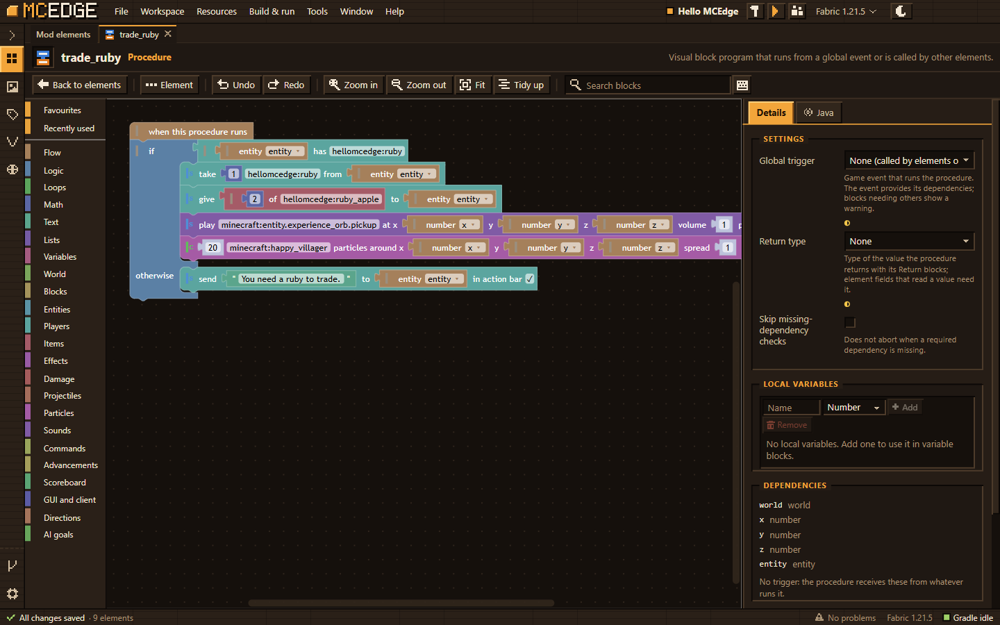
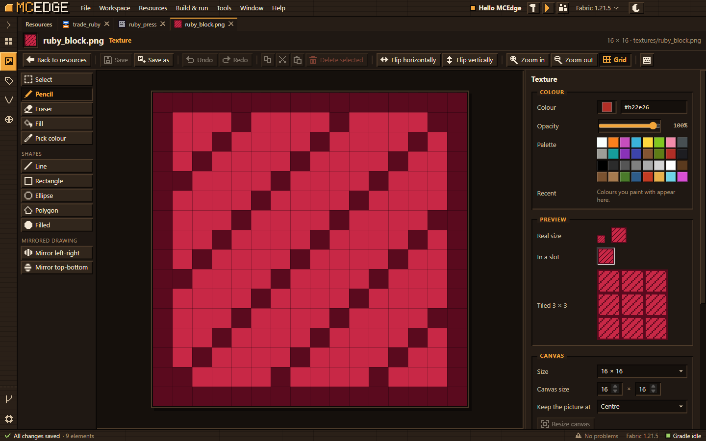
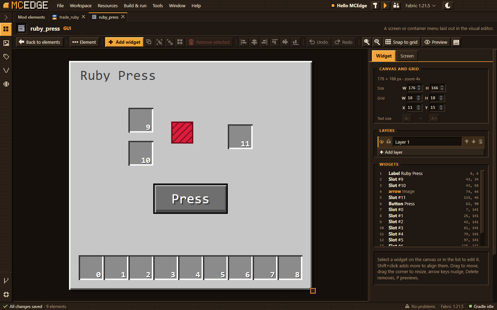
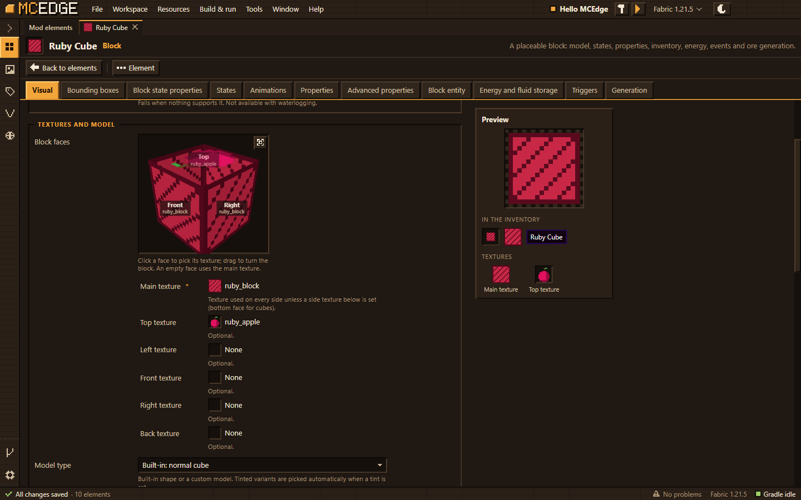
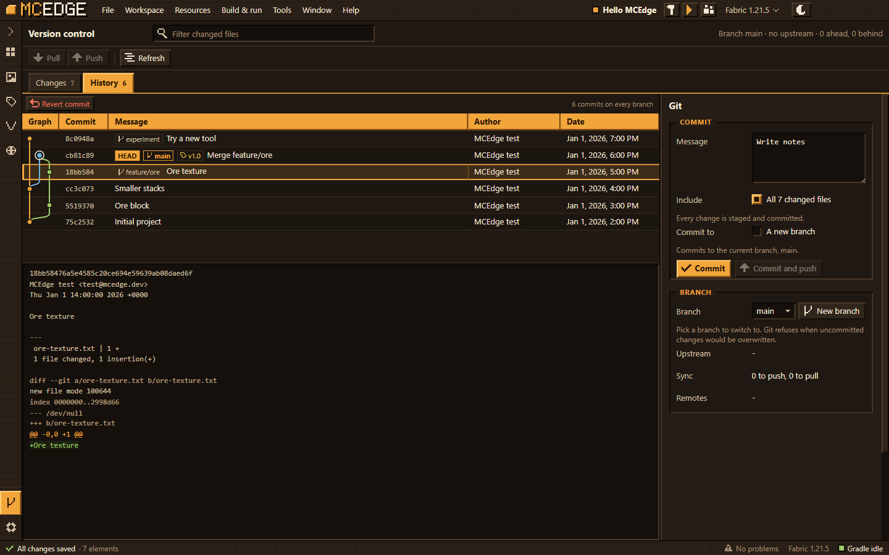
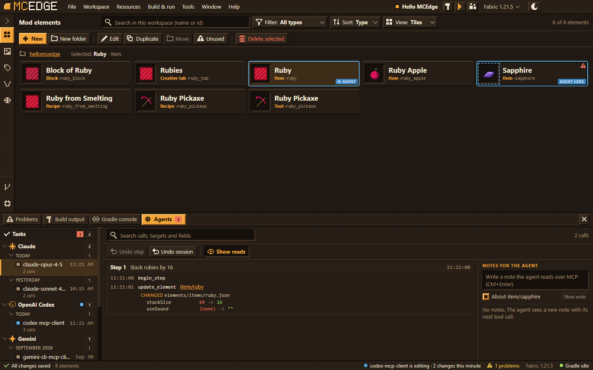

# MCEdge

[English](README.md) | [Türkçe](README.tr.md) | [Deutsch](README.de.md) | **Español** | [简体中文](README.zh-CN.md)

MCEdge es un editor de escritorio para crear mods de Minecraft sin escribir Java, en la línea de MCreator. Describes
tu mod como elementos (ítems, bloques, herramientas, interfaces, entidades, recetas...) y como procedimientos hechos
con bloques, y MCEdge genera y compila el mismo mod para cinco versiones del juego y cargadores: Forge, NeoForge y
Fabric. Un proyecto es una carpeta normal de archivos JSON y texturas, así que encaja bien con Git, y los agentes de
programación con IA pueden leerlo y editarlo en vivo mediante un servidor MCP integrado.

## Capturas

| | |
| --- | --- |
|  |  |
| Los procedimientos se arman con bloques y se compilan a Java para cada motor. | Editor de texturas píxel a píxel con formas, espejo, vistas previas y fotogramas de animación. |
|  |  |
| Editor visual de diseño para interfaces (GUI) y overlays del HUD. | Texturas del bloque sobre un cubo 3D: haz clic en una cara para elegir su textura. |
|  |  |
| Control de versiones con gráfico de ramas, commit, ramas, pull y push. | Lista de elementos y panel de agentes: qué cambió cada agente de IA, paso a paso, con deshacer. |

## Funciones

**Elementos del mod**

- 37 tipos de elemento: ítem, bloque, herramienta, armadura, receta, pestaña creativa, tabla de botín, interfaz,
  overlay, procedimiento, comando, entidad viva, proyectil, fluido, planta, encantamiento, efecto de poción,
  partícula, cuadro, bioma, estructura, dimensión, profesión y comercio de aldeano, regla de juego, asignación de
  tecla, logro y más.
- Formularios con ayuda, vista previa en vivo y validación por campo; un panel de problemas con niveles de gravedad
  y reglas para ignorar.
- Carpetas, búsqueda, filtros, buscar usos, renombrar actualizando referencias, detectar elementos sin usar,
  plantillas y "Create pack" (conjuntos de mineral, herramienta, armadura, madera o material a partir de un nombre y
  un color).
- Etiquetas (tags), variables globales y eventos de sonido.

**Procedimientos**

- Editor Blockly con unos 430 bloques por categorías (flujo, lógica, matemáticas, mundo, entidades, jugadores,
  ítems, efectos, partículas, sonidos, interfaz y cliente, objetivos de IA...).
- Disparadores globales (eventos del juego), lado cliente y servidor con paquetes generados, valores de retorno y
  variables locales.
- El Java generado de un procedimiento se muestra junto a sus bloques.

**Recursos**

- Editor de texturas: lápiz, relleno, formas, selección, dibujo en espejo, tono y desaturar, tamaño del lienzo,
  fotogramas de animación (`.mcmeta`) y vista previa en vivo en una ranura y en mosaico.
- Vista previa 3D de modelos de bloques e ítems; caras del bloque sobre un cubo; integración con Blockbench para
  modelos JSON.
- Editor de diseño de interfaces y overlays con capas, cuadrícula, alineación y vista previa.
- Importación de texturas, sonidos, modelos y estructuras.

**Compilar y ejecutar**

- Un proyecto, cinco motores (ver abajo). El JDK y Gradle de cada motor se descargan la primera vez que se usan.
- Compila un motor o todos, ejecuta el cliente y un servidor dedicado, abre varios clientes con distintos nombres de
  jugador para probar el multijugador, cliente de depuración.
- Los errores de compilación del código generado señalan el elemento que los causó.
- Exporta los jars del mod para los motores que elijas; exporta todo el espacio de trabajo a un zip.
- Las dependencias de Modrinth, CurseForge o Maven se descargan para las pruebas.
- Código generado bloqueado: tus cambios a mano en el Java generado de un elemento se conservan al regenerar.

**Herramientas de proyecto**

- Localización: todos los idiomas lado a lado, textos que faltan, importación y exportación en CSV y lang JSON.
- Control de versiones: cambios, commit, ramas, historial con gráfico de ramas, revertir, pull y push (usa tu Git).
- Modo de proyecto de código: abre un mod Gradle normal y edita sus archivos en el editor Monaco.
- Interfaz en inglés y turco, tema oscuro y claro.

**Agentes de IA (MCP)**

- Un servidor Model Context Protocol con 144 herramientas cubre lo que hace la aplicación: elementos,
  procedimientos, texturas, diseños de interfaz, localización, etiquetas, compilaciones, ejecución de cliente y
  servidor, registros, capturas de la ventana del juego y Git.
- Edición conjunta en vivo: tú y el agente podéis trabajar en el mismo proyecto a la vez; los editores abiertos
  integran los cambios del agente campo por campo.
- El panel de agentes lista las sesiones por agente (Claude, Codex, Gemini y otros), muestra cada paso con las
  diferencias por campo y deshace un paso o una sesión entera. Desde la aplicación puedes dejar notas y tareas al
  agente.

## Motores compatibles

| Motor | Cargador | Minecraft | Java del mod | Gradle (corre sobre JDK) |
| --- | --- | --- | --- | --- |
| `forge-1.16.5` | Forge 36.2.39 | 1.16.5 | 8 | 7.6.4 (JDK 8) |
| `neoforge-1.21.5` | NeoForge 21.5.101 | 1.21.5 | 21 | 9.8.2 (JDK 25) |
| `neoforge-26.3` | NeoForge 26.3.0.99 | 26.3 | 25 | 9.8.2 (JDK 25) |
| `fabric-1.21.5` | Fabric Loader 0.20.1, Fabric API 0.128.2 | 1.21.5 | 21 | 9.8.2 (JDK 25) |
| `fabric-26.3` | Fabric Loader 0.20.1, Fabric API 0.165.0 | 26.3 | 25 | 9.8.2 (JDK 25) |

Los motores se definen en [`engines/`](engines). Cuando un motor no puede generar un campo, bloque o disparador, la
aplicación lo indica (la lista de elementos puede filtrar los que un motor no genera).

## Descarga e instalación

MCEdge funciona en Windows (x64). Descárgalo de
[GitHub Releases](https://github.com/SalihEfeTosunBayraktar/MCEdge/releases):

- `MCEdge-Setup-<versión>.exe` instala MCEdge para tu usuario (puedes elegir la carpeta) y se actualiza solo desde
  GitHub Releases.
- `MCEdge-Portable-<versión>.exe` funciona sin instalar. No se actualiza solo; te avisa cuando sale una versión
  nueva.

La primera compilación o ejecución de un motor descarga su JDK (Eclipse Temurin de Adoptium) y Gradle en
`%APPDATA%\MCEdge\toolchains`; después Gradle descarga Minecraft y el cargador. Tarda unos minutos una vez por motor y
necesita conexión a internet. El control de versiones necesita [Git](https://git-scm.com/) en el `PATH`.

## Inicio rápido

1. Abre MCEdge y elige **File > Open example project** (Hello MCEdge: un ítem de rubí, un bloque, un pico, recetas y
   una pestaña creativa) o **File > New project...**.
2. Haz doble clic en un elemento para editarlo, o pulsa **New** para añadir uno.
3. Elige un motor arriba a la derecha y luego **Build & run > Run client** (F5) para abrir Minecraft con tu mod.
4. **File > Export mod jar...** (Ctrl+E) escribe los jars de los motores que elijas.

La guía de uso se abre desde **Help > User guide...** ([docs/guide/en](docs/guide/en), en inglés y turco).

## Agentes de IA por MCP

El servidor MCP trabaja sobre una carpeta de proyecto y se comunica por stdio; lo arranca tu cliente de IA. Viene con
la aplicación instalada, así que el equipo del agente no necesita Node.js ni una copia del código: el cliente ejecuta
`MCEdge.exe` como Node (`ELECTRON_RUN_AS_NODE=1`) con el servidor incluido en la aplicación, sin abrir ninguna
ventana. **Help > Connect an AI agent** (también *Connect an agent* en el panel de agentes) muestra el comando exacto
para tu instalación y el proyecto abierto, con configuraciones listas para copiar para Claude Code, Codex, Gemini CLI,
Cursor y otros clientes.

Con la instalación por usuario predeterminada, para Claude Code:

```
claude mcp add --transport stdio --env ELECTRON_RUN_AS_NODE=1 mcedge -- "C:\Users\you\AppData\Local\Programs\MCEdge\MCEdge.exe" "C:\Users\you\AppData\Local\Programs\MCEdge\resources\app.asar\out\cli\index.js" mcp "C:\mods\my-mod"
```

Los clientes con configuración JSON (Gemini CLI `~/.gemini/settings.json`, Cursor `.cursor/mcp.json`, Claude Desktop
y otros) reciben el mismo comando; Codex lo recibe como `[mcp_servers.mcedge]` en `~/.codex/config.toml`:

```json
{
  "mcpServers": {
    "mcedge": {
      "command": "C:\\Users\\you\\AppData\\Local\\Programs\\MCEdge\\MCEdge.exe",
      "args": ["C:\\Users\\you\\AppData\\Local\\Programs\\MCEdge\\resources\\app.asar\\out\\cli\\index.js", "mcp", "C:\\mods\\my-mod"],
      "env": { "ELECTRON_RUN_AS_NODE": "1" }
    }
  }
}
```

El exe portable no puede servir a agentes (se descomprime en una carpeta temporal que se borra al cerrarlo); para MCP
instala MCEdge con el instalador.

Desde una copia del código fuente (ver [Compilar desde el código](#compilar-desde-el-código); basta con
`npm install`) el mismo servidor se ejecuta con Node.js:

```
node <copia de MCEdge>/src/cli.ts mcp <carpeta del proyecto>
claude mcp add mcedge -- node C:/src/MCEdge/src/cli.ts mcp C:/mods/my-mod
```

Mantén el proyecto abierto en MCEdge para seguir el trabajo del agente en el panel de agentes. Todas las
herramientas están en [docs/MCP.md](docs/MCP.md). También funciona con una carpeta de mod Gradle normal, con las
herramientas de archivos, compilación, ejecución y Git.

## Compilar desde el código

Requisitos: Windows, [Node.js](https://nodejs.org/) 24 (el núcleo ejecuta directamente sus fuentes TypeScript) y Git.

```
git clone https://github.com/SalihEfeTosunBayraktar/MCEdge.git
cd MCEdge
npm install
npm run dev          # la aplicación con recarga en caliente
npm run build:app    # compila en out/; npm start ejecuta la aplicación compilada
npm run dist         # instalador de Windows y exe portable en release/
npm run typecheck
```

La línea de comandos compila un proyecto sin la aplicación:

```
node src/cli.ts build examples/hello --target fabric-1.21.5   # o --target all; --no-gradle solo genera
node src/cli.ts engines
```

## Estructura del proyecto

| Ruta | Contenido |
| --- | --- |
| `app/` | Aplicación Electron: proceso principal, preload e interfaz React |
| `src/` | Núcleo: modelo de proyecto, validación, generador de código, procedimientos, compilación y ejecución con Gradle, Git, servidor MCP, CLI |
| `element-types/` | Un `type.json` por tipo de elemento: páginas, campos y valores por defecto |
| `engines/`, `layers/` | Ajustes de cada motor y las plantillas de código que comparten |
| `config/` | Bloques de procedimiento, textos de la interfaz (en, tr), descargas de toolchains, ids vanilla |
| `schemas/` | Esquemas JSON de proyectos y motores |
| `examples/hello/` | El proyecto de ejemplo incluido |
| `docs/` | Guía de uso, [referencia MCP](docs/MCP.md), [formato de los tipos de elemento](docs/ELEMENT-TYPES.md) |
| `tools/` | Pruebas de interfaz (`ui-test`), pruebas MCP (`mcp-test`), pruebas del código generado en cada motor (`codegen-test`) |

## Contribuir

Los issues y pull requests son bienvenidos. Antes de un pull request, ejecuta `npm run typecheck`; los cambios en el
generador deben compilar en todos los motores (`tools/codegen-test`), y para cambios de interfaz hay scripts en
`tools/ui-test` que manejan la aplicación real. El código, los comentarios y los mensajes de commit van en inglés.

## Licencia

MCEdge es software libre bajo la Licencia Pública General de GNU, versión 3 o (a tu elección) cualquier versión
posterior (GPL-3.0-or-later). Consulta [LICENSE](LICENSE).

Los mods que creas con MCEdge son tuyos. Como en MCreator, el código que MCEdge genera para tu mod no está cubierto
por la licencia de MCEdge; la licencia de tu mod la eliges en Workspace settings.
