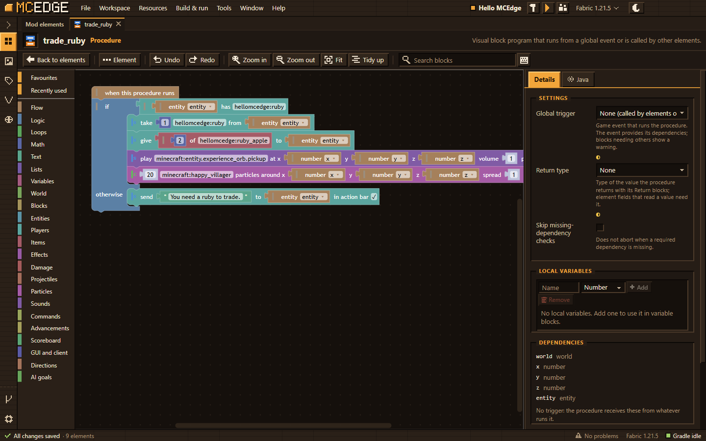
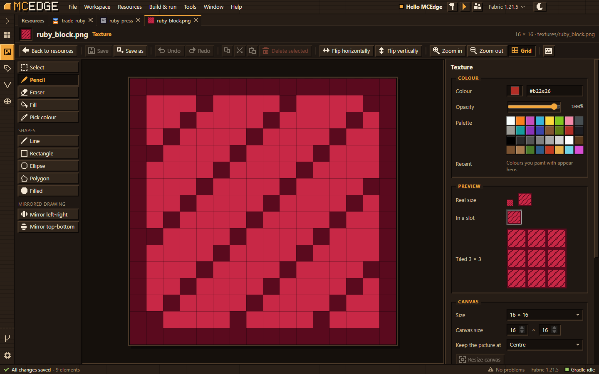
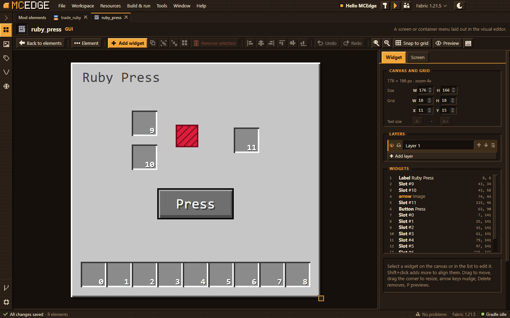
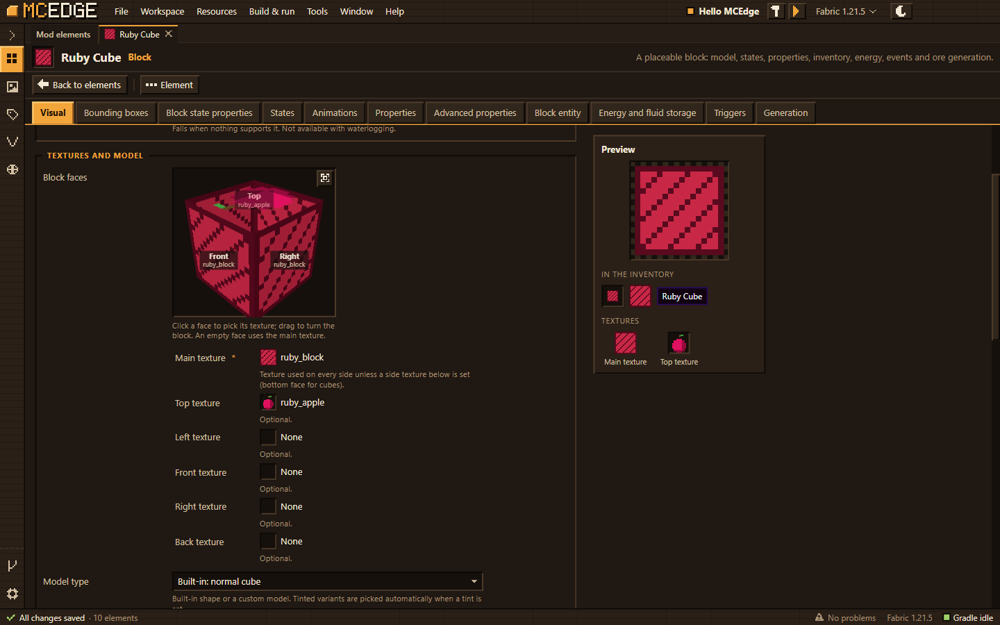
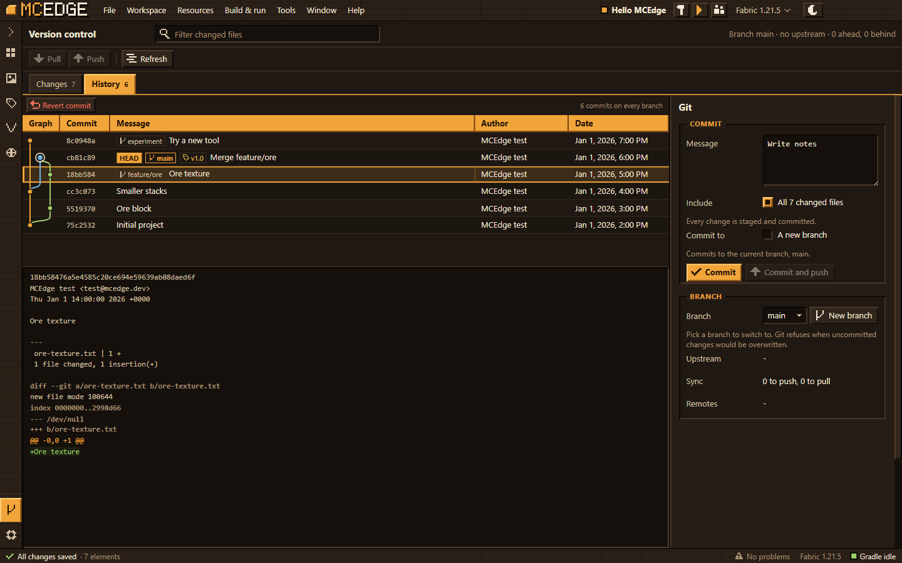
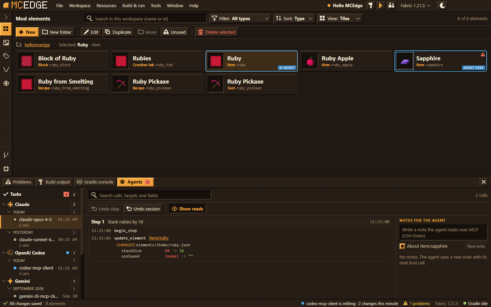

# MCEdge

**English** | [Türkçe](README.tr.md) | [Deutsch](README.de.md) | [Español](README.es.md) | [简体中文](README.zh-CN.md)

MCEdge is a desktop editor for making Minecraft mods without writing Java, in the spirit of MCreator. You describe
your mod as elements (items, blocks, tools, GUIs, entities, recipes...) and as block-based procedures, and MCEdge
generates and builds the same mod for five game versions and loaders: Forge, NeoForge and Fabric. A project is a
plain folder of JSON files and textures, so it works well with Git, and AI coding agents can read and edit it live
through a built-in MCP server.

## Screenshots

| | |
| --- | --- |
|  |  |
| Procedures are built from blocks and compiled to Java for every engine. | Pixel texture editor with shapes, mirroring, previews and animation frames. |
|  |  |
| Visual layout editor for GUIs and HUD overlays. | Block textures on a 3D cube: click a face to pick its texture. |
|  |  |
| Version control with a branch graph, commit, branch, pull and push. | Element list and the Agents panel: what each AI agent changed, step by step, with undo. |

## Features

**Mod elements**

- 37 element types: item, block, tool, armor, recipe, creative tab, loot table, GUI, overlay, procedure, command,
  living entity, projectile, fluid, plant, enchantment, potion effect, particle, painting, biome, structure,
  dimension, villager profession and trade, game rule, key binding, advancement and more.
- Forms with help text, live previews and per-field validation; a Problems panel with severities and ignore rules.
- Folders, search, filters, find usages, rename with reference updates, unused-element finder, templates and
  "create pack" (ore, tool, armor, wood or material sets from one name and colour).
- Element tags, global variables and sound events.

**Procedures**

- Blockly editor with about 430 blocks in categories (flow, logic, math, world, entities, players, items, effects,
  particles, sounds, GUI and client, AI goals...).
- Global triggers (game events), client and server sides with generated packets, return values and local variables.
- The generated Java of a procedure is shown next to its blocks.

**Resources**

- Texture editor: pencil, fill, shapes, selection, mirrored drawing, hue and desaturate, canvas resize, animation
  frames (`.mcmeta`), and live previews in a slot and tiled.
- 3D preview of block and item models; block faces on a cube; Blockbench integration for JSON models.
- GUI and overlay layout editor with layers, grid snapping, alignment and preview.
- Import of textures, sounds, models and structures.

**Build and run**

- One project, five engines (see below). Each engine's JDK and Gradle are downloaded on first use.
- Build one engine or all of them, run the client and a dedicated server, start several clients with different
  player names to test multiplayer, debug client.
- Build errors in generated code point back to the element that caused them.
- Export the mod jars for the engines you choose; export the whole workspace to a zip.
- Mod dependencies from Modrinth, CurseForge or Maven are downloaded for test runs.
- Locked generated code: keep hand edits to an element's generated Java across regenerations.

**Project tools**

- Localization screen: every language side by side, missing texts, CSV and lang JSON import and export.
- Version control: changes, commit, branches, history with a branch graph, revert, pull and push (uses your Git).
- Code project mode: open a plain Gradle mod and edit its files in a Monaco editor.
- Interface in English and Turkish, dark and light themes.

**AI agents (MCP)**

- A Model Context Protocol server with 144 tools covers what the app does: elements, procedures, textures, GUI
  layouts, localization, tags, builds, client and server runs, logs, screenshots of the game window, Git.
- Live co-editing: you and the agent can work on the same project at the same time; open editors merge the
  agent's changes field by field.
- The Agents panel lists sessions per agent (Claude, Codex, Gemini and others), shows every step with a field-level
  diff, and undoes a step or a whole session. You can leave notes and tasks for the agent from the app.

## Supported engines

| Engine | Loader | Minecraft | Mod Java | Gradle (runs on JDK) |
| --- | --- | --- | --- | --- |
| `forge-1.16.5` | Forge 36.2.39 | 1.16.5 | 8 | 7.6.4 (JDK 8) |
| `neoforge-1.21.5` | NeoForge 21.5.101 | 1.21.5 | 21 | 9.8.2 (JDK 25) |
| `neoforge-26.3` | NeoForge 26.3.0.99 | 26.3 | 25 | 9.8.2 (JDK 25) |
| `fabric-1.21.5` | Fabric Loader 0.20.1, Fabric API 0.128.2 | 1.21.5 | 21 | 9.8.2 (JDK 25) |
| `fabric-26.3` | Fabric Loader 0.20.1, Fabric API 0.165.0 | 26.3 | 25 | 9.8.2 (JDK 25) |

Engines are defined in [`engines/`](engines). Where an engine cannot generate a field, block or trigger, the app
says so (the element list can filter for elements an engine does not generate).

## Download and install

MCEdge runs on Windows (x64). Download it from
[GitHub Releases](https://github.com/SalihEfeTosunBayraktar/MCEdge/releases):

- `MCEdge-Setup-<version>.exe` installs MCEdge for your user (you can choose the folder) and updates itself from
  GitHub Releases.
- `MCEdge-Portable-<version>.exe` runs without installing. It does not update itself; it tells you when a new
  release is out.

The first build or run of an engine downloads its JDK (Eclipse Temurin from Adoptium) and Gradle into
`%APPDATA%\MCEdge\toolchains`, and Gradle then downloads Minecraft and the loader. This takes a few minutes once
per engine and needs an internet connection. Version control needs [Git](https://git-scm.com/) on your `PATH`.

## Quick start

1. Start MCEdge and choose **File > Open example project** (Hello MCEdge: a ruby item, block, pickaxe, recipes and
   a creative tab), or **File > New project...**.
2. Double-click an element to edit it, or press **New** to add one.
3. Pick an engine in the top right, then **Build & run > Run client** (F5) to start Minecraft with your mod.
4. **File > Export mod jar...** (Ctrl+E) writes the jars for the engines you choose.

The user guide opens from **Help > User guide...** ([docs/guide/en](docs/guide/en), also in Turkish).

## AI agents over MCP

The MCP server works on one project folder and talks over stdio; your AI client starts it. It comes with the
installed app, so the agent's computer needs no Node.js or source checkout: the client runs `MCEdge.exe` as Node
(`ELECTRON_RUN_AS_NODE=1`) on the server bundled in the app, and no window opens. **Help > Connect an AI agent**
(also *Connect an agent* in the Agents panel) shows the exact command for your installation and the open project, with
ready-to-copy setup for Claude Code, Codex, Gemini CLI, Cursor and other clients.

With the default per-user install, for Claude Code:

```
claude mcp add --transport stdio --env ELECTRON_RUN_AS_NODE=1 mcedge -- "C:\Users\you\AppData\Local\Programs\MCEdge\MCEdge.exe" "C:\Users\you\AppData\Local\Programs\MCEdge\resources\app.asar\out\cli\index.js" mcp "C:\mods\my-mod"
```

Clients with a JSON config (Gemini CLI `~/.gemini/settings.json`, Cursor `.cursor/mcp.json`, Claude Desktop and
others) take the same command; Codex takes it as `[mcp_servers.mcedge]` in `~/.codex/config.toml`:

```json
{
  "mcpServers": {
    "mcedge": {
      "command": "C:\\Users\\you\\AppData\\Local\\Programs\\MCEdge\\MCEdge.exe",
      "args": ["C:\\Users\\you\\AppData\\Local\\Programs\\MCEdge\\resources\\app.asar\\out\\cli\\index.js", "mcp", "C:\\mods\\my-mod"],
      "env": { "ELECTRON_RUN_AS_NODE": "1" }
    }
  }
}
```

The portable exe cannot serve agents (it unpacks to a temporary folder that is deleted when it closes); install
MCEdge with the setup program for MCP.

From a source checkout (see [Build from source](#build-from-source); `npm install` is enough) the same server runs
with Node.js:

```
node <MCEdge checkout>/src/cli.ts mcp <project folder>
claude mcp add mcedge -- node C:/src/MCEdge/src/cli.ts mcp C:/mods/my-mod
```

Keep the project open in MCEdge to watch the agent work in the Agents panel. Every tool is listed in
[docs/MCP.md](docs/MCP.md). A plain Gradle mod folder works too, with the file, build, run and Git tools.

## Build from source

Requirements: Windows, [Node.js](https://nodejs.org/) 24 (the core runs its TypeScript sources directly) and Git.

```
git clone https://github.com/SalihEfeTosunBayraktar/MCEdge.git
cd MCEdge
npm install
npm run dev          # the app with hot reload
npm run build:app    # build into out/; npm start runs the built app
npm run dist         # Windows installer and portable exe into release/
npm run typecheck
```

The command line builds a project without the app:

```
node src/cli.ts build examples/hello --target fabric-1.21.5   # or --target all, --no-gradle to only generate
node src/cli.ts engines
```

## Project layout

| Path | What it holds |
| --- | --- |
| `app/` | Electron app: main process, preload and the React renderer |
| `src/` | Core: project model, validation, code generator, procedures, Gradle builds and runs, Git, MCP server, CLI |
| `element-types/` | One `type.json` per element type: its pages, fields and defaults |
| `engines/`, `layers/` | Per-engine settings and the code templates they share |
| `config/` | Procedure blocks, UI strings (en, tr), toolchain downloads, vanilla ids |
| `schemas/` | JSON schemas for projects and engines |
| `examples/hello/` | The bundled example project |
| `docs/` | User guide, [MCP reference](docs/MCP.md), [element type format](docs/ELEMENT-TYPES.md) |
| `tools/` | UI tests (`ui-test`), MCP tests (`mcp-test`), generated-code tests on every engine (`codegen-test`) |

## Contributing

Issues and pull requests are welcome. Before a pull request, run `npm run typecheck`; changes to the generator
should build on every engine (`tools/codegen-test`), and UI changes have scripts in `tools/ui-test` that drive the
real app. Code, comments and commit messages are in English.

## License

MCEdge is free software under the GNU General Public License, version 3 or (at your option) any later version
(GPL-3.0-or-later). See [LICENSE](LICENSE).

The mods you make with MCEdge are yours. As with MCreator, the code MCEdge generates for your mod is not covered by
MCEdge's license; you choose your mod's license in Workspace settings.
