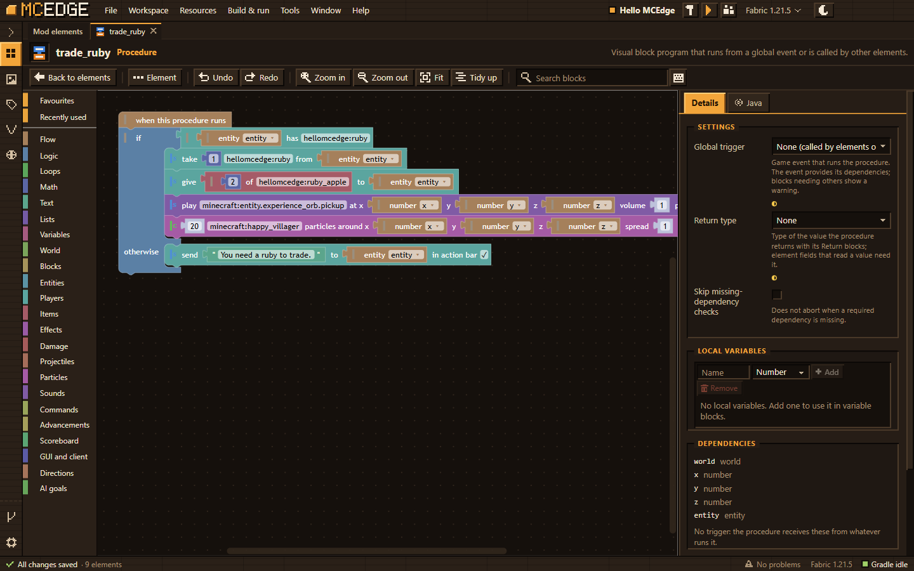
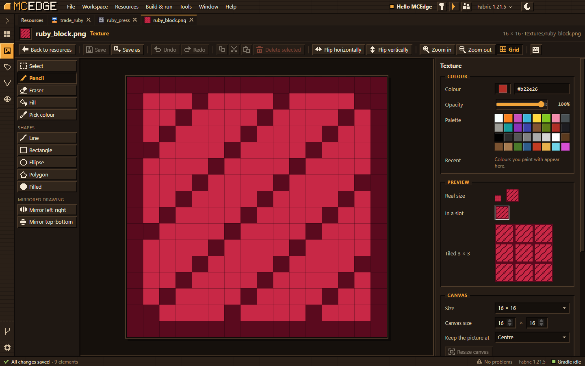
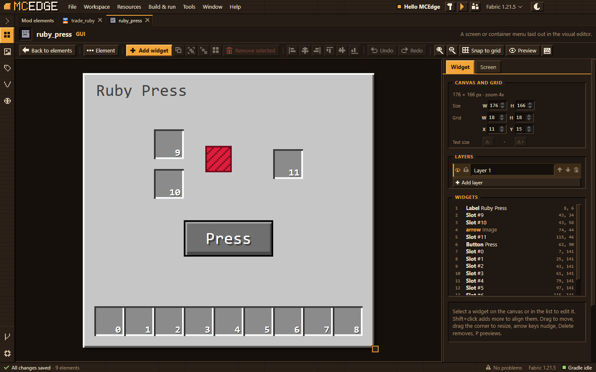
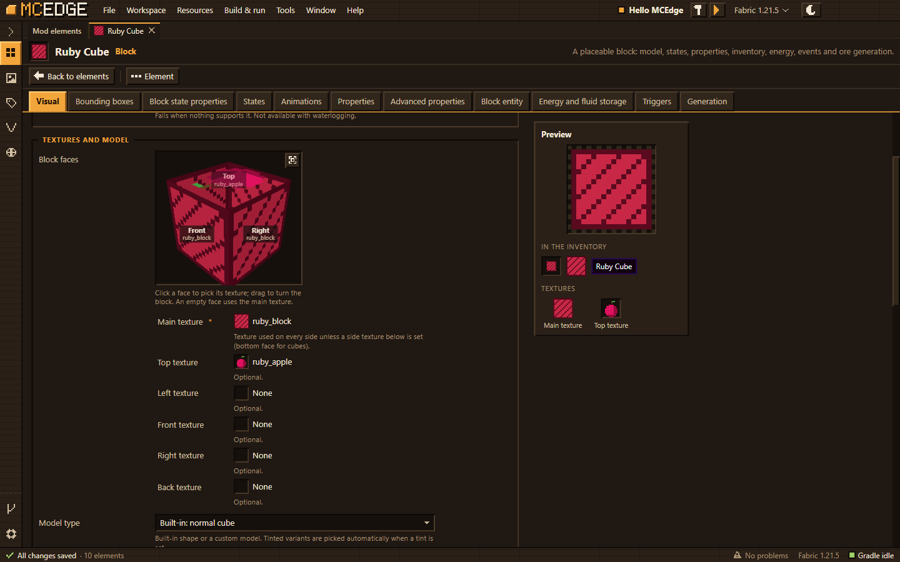
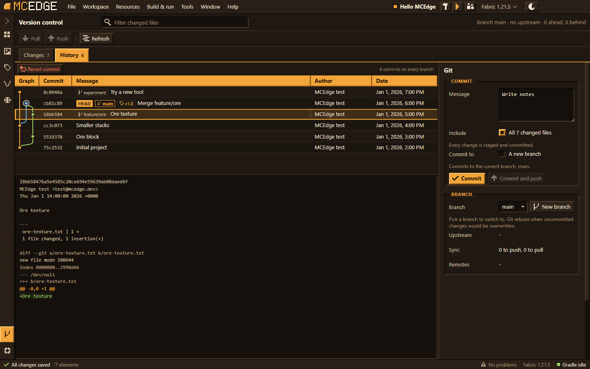
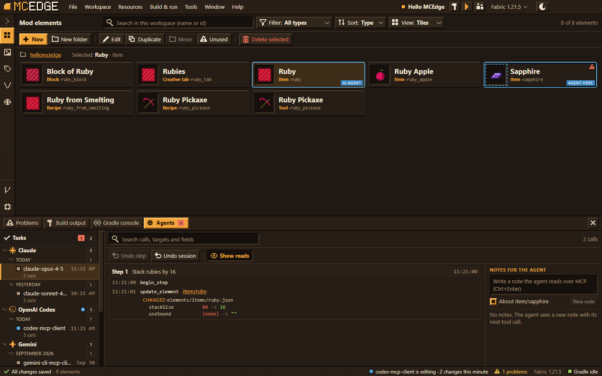

# MCEdge

[English](README.md) | **Türkçe** | [Deutsch](README.de.md) | [Español](README.es.md) | [简体中文](README.zh-CN.md)

MCEdge, Java yazmadan Minecraft modu yapmak için bir masaüstü editörü; MCreator'a bir alternatif. Modunu öğelerle
(eşya, blok, alet, arayüz, varlık, tarif...) ve bloklarla kurulan prosedürlerle tarif edersin; MCEdge aynı modu beş
oyun sürümü ve yükleyici için üretip derler: Forge, NeoForge ve Fabric. Proje sıradan bir JSON ve doku klasörü
olduğundan Git ile rahat çalışır; yapay zeka kodlama ajanları da yerleşik MCP sunucusu üzerinden projeyi canlı
okuyup düzenleyebilir.

## Ekran görüntüleri

| | |
| --- | --- |
|  |  |
| Prosedürler bloklarla kurulur, her motor için Java'ya derlenir. | Şekiller, aynalı çizim, önizleme ve animasyon kareleriyle piksel doku editörü. |
|  |  |
| Arayüz (GUI) ve ekran katmanı (overlay) için görsel yerleşim editörü. | Blok dokuları 3B küp üzerinde: bir yüze tıklayıp dokusunu seçersin. |
|  |  |
| Dal grafiğiyle sürüm kontrolü: commit, dal, pull ve push. | Öğe listesi ve Ajanlar paneli: her yapay zeka ajanının adım adım ne değiştirdiği, geri alma ile. |

## Özellikler

**Mod öğeleri**

- 37 öğe türü: eşya, blok, alet, zırh, tarif, yaratıcı sekme, ganimet tablosu, arayüz, overlay, prosedür, komut,
  canlı varlık, mermi, sıvı, bitki, büyü, iksir etkisi, parçacık, tablo, biyom, yapı, boyut, köylü mesleği ve
  takası, oyun kuralı, tuş ataması, başarım ve daha fazlası.
- Açıklamalı formlar, canlı önizleme ve alan bazında doğrulama; önem dereceli ve yok sayılabilen Sorunlar paneli.
- Klasörler, arama, filtreler, kullanım yerlerini bulma, referansları güncelleyerek yeniden adlandırma, kullanılmayan
  öğeleri bulma, şablonlar ve "paket oluştur" (tek ad ve renkten cevher, alet, zırh, ahşap ya da malzeme seti).
- Öğe etiketleri (tag), genel değişkenler ve ses olayları.

**Prosedürler**

- Kategorilere ayrılmış yaklaşık 430 bloklu Blockly editörü (akış, mantık, matematik, dünya, varlıklar, oyuncular,
  eşyalar, efektler, parçacıklar, sesler, arayüz ve istemci, yapay zeka hedefleri...).
- Genel tetikleyiciler (oyun olayları), paketleri otomatik üretilen istemci ve sunucu tarafları, dönüş değerleri ve
  yerel değişkenler.
- Prosedürün ürettiği Java kodu blokların yanında görünür.

**Kaynaklar**

- Doku editörü: kalem, doldurma, şekiller, seçim, aynalı çizim, renk tonu ve renk giderme, tuval boyutlandırma,
  animasyon kareleri (`.mcmeta`), slotta ve döşenmiş canlı önizleme.
- Blok ve eşya modellerinin 3B önizlemesi; küp üzerinde blok yüzleri; JSON modeller için Blockbench entegrasyonu.
- Katmanlı, ızgaraya yapışan, hizalama ve önizleme destekli arayüz ve overlay yerleşim editörü.
- Doku, ses, model ve yapı içe aktarma.

**Derleme ve çalıştırma**

- Tek proje, beş motor (aşağıya bak). Her motorun JDK'si ve Gradle'ı ilk kullanımda indirilir.
- Tek motoru ya da hepsini derle, istemciyi ve ayrık sunucuyu çalıştır, çok oyunculuyu denemek için farklı oyuncu
  adlarıyla birden çok istemci aç, hata ayıklama istemcisi başlat.
- Üretilen koddaki derleme hataları, hataya yol açan öğeyi gösterir.
- Seçtiğin motorların mod jar'larını dışa aktar; bütün çalışma alanını zip olarak dışa aktar.
- Modrinth, CurseForge ya da Maven'dan mod bağımlılıkları test çalıştırmaları için indirilir.
- Kilitli üretilmiş kod: bir öğenin üretilen Java'sına elle yaptığın değişiklikler yeniden üretimde korunur.

**Proje araçları**

- Yerelleştirme ekranı: bütün diller yan yana, eksik metinler, CSV ve lang JSON içe ve dışa aktarma.
- Sürüm kontrolü: değişiklikler, commit, dallar, dal grafiğiyle geçmiş, geri alma, pull ve push (bilgisayardaki
  Git'i kullanır).
- Kod projesi modu: sıradan bir Gradle modunu açıp dosyalarını Monaco editöründe düzenle.
- İngilizce ve Türkçe arayüz, koyu ve açık tema.

**Yapay zeka ajanları (MCP)**

- 144 araçlı bir Model Context Protocol sunucusu uygulamanın yaptığı işleri kapsar: öğeler, prosedürler, dokular,
  arayüz yerleşimleri, yerelleştirme, etiketler, derleme, istemci ve sunucu çalıştırma, loglar, oyun penceresinin
  ekran görüntüsü, Git.
- Canlı ortak düzenleme: sen ve ajan aynı projede aynı anda çalışabilirsiniz; açık editörler ajanın değişikliklerini
  alan alan birleştirir.
- Ajanlar paneli oturumları ajana göre listeler (Claude, Codex, Gemini ve diğerleri), her adımı alan düzeyinde
  farkıyla gösterir, bir adımı ya da bütün oturumu geri alır. Uygulamadan ajana not ve görev bırakabilirsin.

## Desteklenen motorlar

| Motor | Yükleyici | Minecraft | Mod Java'sı | Gradle (çalıştığı JDK) |
| --- | --- | --- | --- | --- |
| `forge-1.16.5` | Forge 36.2.39 | 1.16.5 | 8 | 7.6.4 (JDK 8) |
| `neoforge-1.21.5` | NeoForge 21.5.101 | 1.21.5 | 21 | 9.8.2 (JDK 25) |
| `neoforge-26.3` | NeoForge 26.3.0.99 | 26.3 | 25 | 9.8.2 (JDK 25) |
| `fabric-1.21.5` | Fabric Loader 0.20.1, Fabric API 0.128.2 | 1.21.5 | 21 | 9.8.2 (JDK 25) |
| `fabric-26.3` | Fabric Loader 0.20.1, Fabric API 0.165.0 | 26.3 | 25 | 9.8.2 (JDK 25) |

Motorlar [`engines/`](engines) altında tanımlıdır. Bir motor bir alanı, bloğu ya da tetikleyiciyi üretemiyorsa
uygulama bunu söyler (öğe listesi, bir motorun üretmediği öğelere göre filtrelenebilir).

## İndirme ve kurulum

MCEdge Windows'ta (x64) çalışır. [GitHub Releases](https://github.com/SalihEfeTosunBayraktar/MCEdge/releases)
sayfasından indir:

- `MCEdge-Setup-<sürüm>.exe` MCEdge'i kendi kullanıcın için kurar (klasörü seçebilirsin) ve GitHub Releases'ten
  kendini günceller.
- `MCEdge-Portable-<sürüm>.exe` kurulum olmadan çalışır. Kendini güncellemez; yeni sürüm çıktığında haber verir.

Bir motorun ilk derlemesi ya da çalıştırılması, o motorun JDK'sini (Adoptium'dan Eclipse Temurin) ve Gradle'ı
`%APPDATA%\MCEdge\toolchains` klasörüne indirir; ardından Gradle Minecraft'ı ve yükleyiciyi indirir. Bu, motor
başına bir kez birkaç dakika sürer ve internet bağlantısı ister. Sürüm kontrolü için `PATH` üzerinde
[Git](https://git-scm.com/) bulunmalı.

## Hızlı başlangıç

1. MCEdge'i aç ve **File > Open example project** seç (Hello MCEdge: yakut eşyası, blok, kazma, tarifler ve bir
   yaratıcı sekme) ya da **File > New project...** ile yeni proje oluştur.
2. Bir öğeyi düzenlemek için çift tıkla, yenisini eklemek için **New**'a bas.
3. Sağ üstten bir motor seç, sonra **Build & run > Run client** (F5) ile Minecraft'ı modunla başlat.
4. **File > Export mod jar...** (Ctrl+E) seçtiğin motorların jar'larını yazar.

Menü adları burada İngilizce arayüze göredir; arayüz dilini **Window > Preferences...** altından Türkçe yapabilirsin.
Kullanım rehberi **Help > User guide...** altında açılır ([docs/guide/tr](docs/guide/tr)).

## MCP üzerinden yapay zeka ajanları

MCP sunucusu tek bir proje klasörü üzerinde çalışır ve stdio ile konuşur; onu yapay zeka istemcin başlatır. Sunucu
kurulu uygulamayla birlikte gelir, ajanın bilgisayarında Node.js ya da kaynak kod gerekmez: istemci `MCEdge.exe`'yi
uygulamaya gömülü sunucuyla Node olarak çalıştırır (`ELECTRON_RUN_AS_NODE=1`), pencere açılmaz. **Yardım > Yapay
zekâ ajanı bağla** (Ajanlar panelinde de *Ajan bağla*) kurulumuna ve açık projeye göre tam komutu, Claude Code,
Codex, Gemini CLI, Cursor ve diğer istemciler için kopyalanmaya hazır ayarlarla gösterir.

Varsayılan kullanıcı kurulumunda Claude Code için:

```
claude mcp add --transport stdio --env ELECTRON_RUN_AS_NODE=1 mcedge -- "C:\Users\you\AppData\Local\Programs\MCEdge\MCEdge.exe" "C:\Users\you\AppData\Local\Programs\MCEdge\resources\app.asar\out\cli\index.js" mcp "C:\mods\my-mod"
```

JSON ayar dosyası kullanan istemciler (Gemini CLI `~/.gemini/settings.json`, Cursor `.cursor/mcp.json`, Claude
Desktop ve diğerleri) aynı komutu alır; Codex onu `~/.codex/config.toml` içinde `[mcp_servers.mcedge]` olarak alır:

```json
{
  "mcpServers": {
    "mcedge": {
      "command": "C:\\Users\\you\\AppData\\Local\\Programs\\MCEdge\\MCEdge.exe",
      "args": ["C:\\Users\\you\\AppData\\Local\\Programs\\MCEdge\\resources\\app.asar\\out\\cli\\index.js", "mcp", "C:\\mods\\my-mod"],
      "env": { "ELECTRON_RUN_AS_NODE": "1" }
    }
  }
}
```

Taşınabilir exe ajanlara hizmet veremez (kapanınca silinen geçici bir klasöre açılır); MCP için MCEdge'i kurulum
programıyla kur.

Kaynak koddan ([Kaynaktan derleme](#kaynaktan-derleme) bölümüne bak; `npm install` yeterli) aynı sunucu Node.js ile
çalışır:

```
node <MCEdge klasörü>/src/cli.ts mcp <proje klasörü>
claude mcp add mcedge -- node C:/src/MCEdge/src/cli.ts mcp C:/mods/my-mod
```

Ajanın çalışmasını Ajanlar panelinden izlemek için projeyi MCEdge'de açık tut. Bütün araçlar
[docs/MCP.md](docs/MCP.md) dosyasında listelenir. Sıradan bir Gradle mod klasörü de çalışır; o zaman dosya, derleme,
çalıştırma ve Git araçları kullanılabilir.

## Kaynaktan derleme

Gerekenler: Windows, [Node.js](https://nodejs.org/) 24 (çekirdek TypeScript kaynaklarını doğrudan çalıştırır) ve Git.

```
git clone https://github.com/SalihEfeTosunBayraktar/MCEdge.git
cd MCEdge
npm install
npm run dev          # anında yeniden yüklemeli uygulama
npm run build:app    # out/ klasörüne derler; npm start derlenmiş uygulamayı çalıştırır
npm run dist         # Windows kurulum ve taşınabilir exe, release/ klasörüne
npm run typecheck
```

Komut satırı bir projeyi uygulama olmadan derler:

```
node src/cli.ts build examples/hello --target fabric-1.21.5   # ya da --target all; yalnız üretmek için --no-gradle
node src/cli.ts engines
```

## Proje yapısı

| Yol | İçinde ne var |
| --- | --- |
| `app/` | Electron uygulaması: ana süreç, preload ve React arayüzü |
| `src/` | Çekirdek: proje modeli, doğrulama, kod üretici, prosedürler, Gradle derleme ve çalıştırma, Git, MCP sunucusu, CLI |
| `element-types/` | Öğe türü başına bir `type.json`: sayfaları, alanları ve varsayılanları |
| `engines/`, `layers/` | Motor ayarları ve paylaştıkları kod şablonları |
| `config/` | Prosedür blokları, arayüz metinleri (en, tr), araç zinciri indirmeleri, vanilla kimlikleri |
| `schemas/` | Projeler ve motorlar için JSON şemaları |
| `examples/hello/` | Uygulamayla gelen örnek proje |
| `docs/` | Kullanım rehberi, [MCP başvurusu](docs/MCP.md), [öğe türü biçimi](docs/ELEMENT-TYPES.md) |
| `tools/` | Arayüz testleri (`ui-test`), MCP testleri (`mcp-test`), her motorda üretilen kod testleri (`codegen-test`) |

## Katkı

Issue ve pull request'ler memnuniyetle karşılanır. Pull request'ten önce `npm run typecheck` çalıştır; kod
üreticideki değişiklikler her motorda derlenmeli (`tools/codegen-test`), arayüz değişiklikleri için gerçek uygulamayı
süren betikler `tools/ui-test` altındadır. Kod, yorumlar ve commit mesajları İngilizce yazılır.

## Lisans

MCEdge, GNU Genel Kamu Lisansı sürüm 3 ya da (tercihine göre) daha sonraki bir sürümü (GPL-3.0-or-later) altında
özgür yazılımdır. Bkz. [LICENSE](LICENSE).

MCEdge ile yaptığın modlar senindir. MCreator'da olduğu gibi, MCEdge'in modun için ürettiği kod MCEdge'in lisansına
tabi değildir; modunun lisansını Workspace settings altında sen seçersin.
