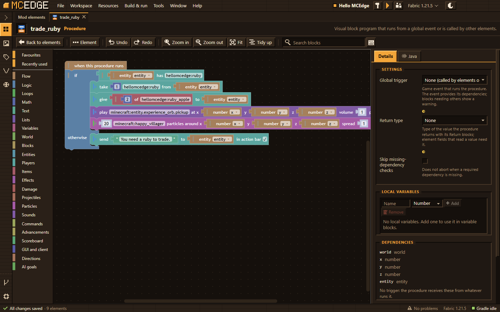
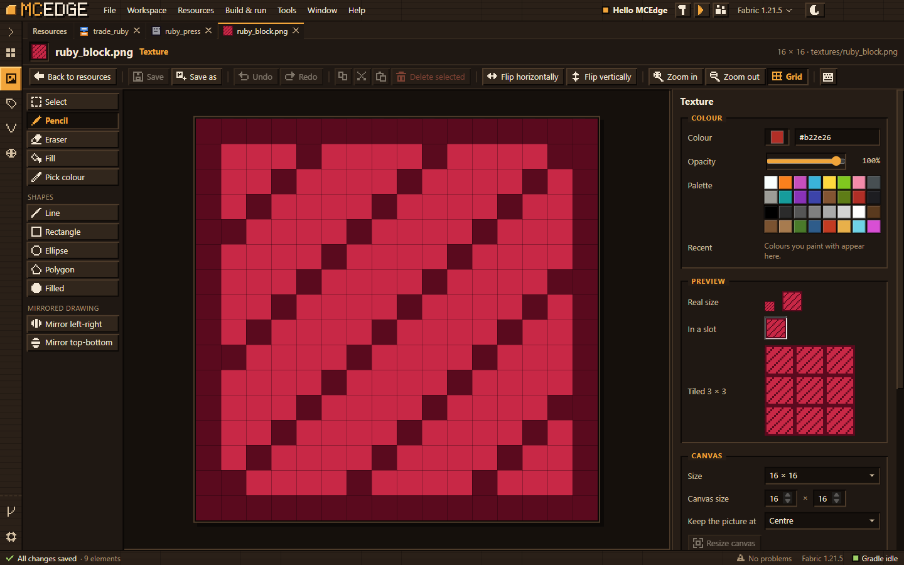
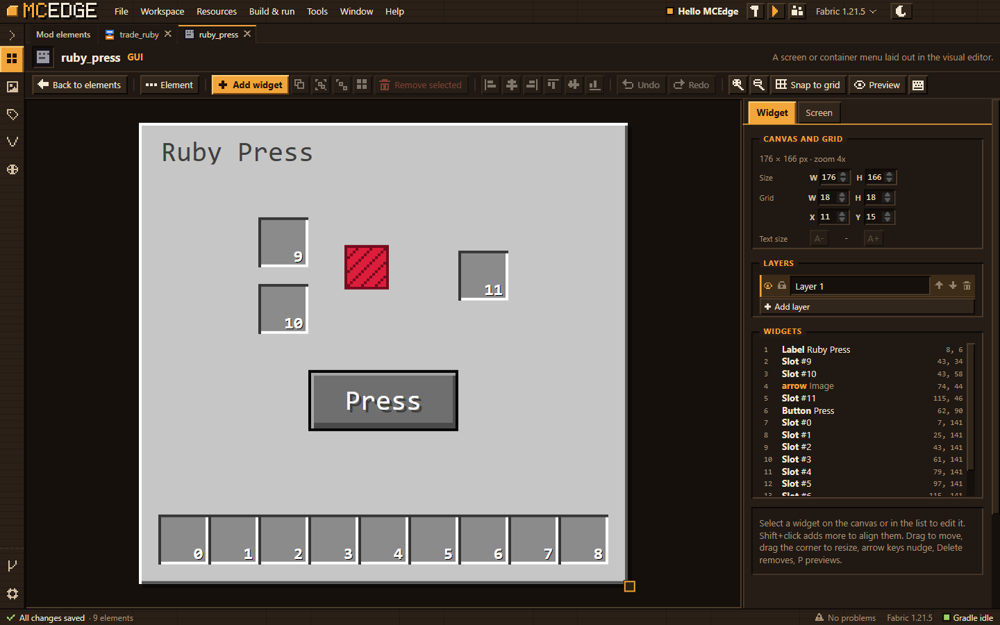
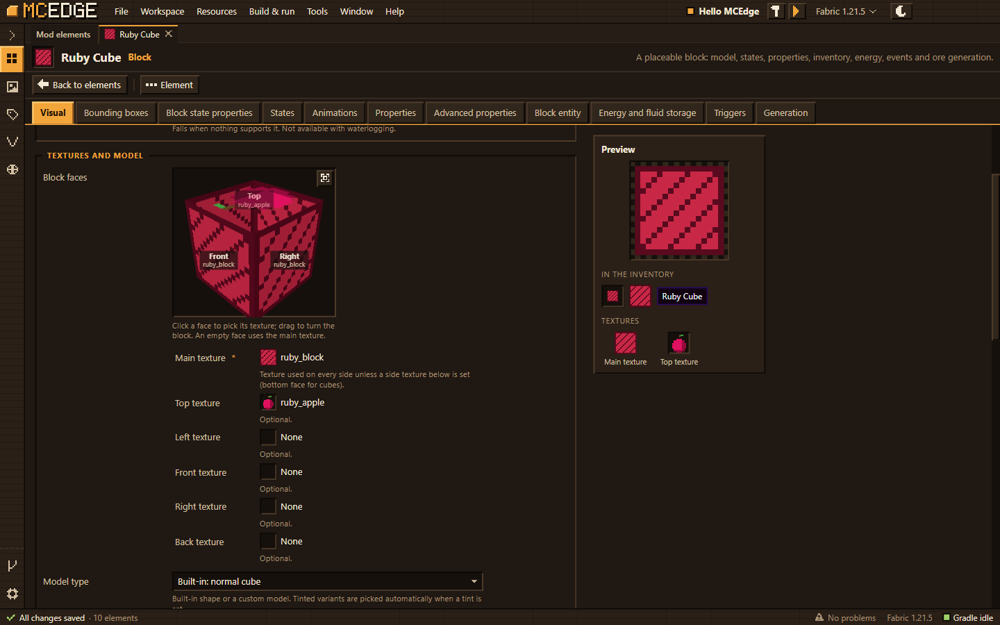
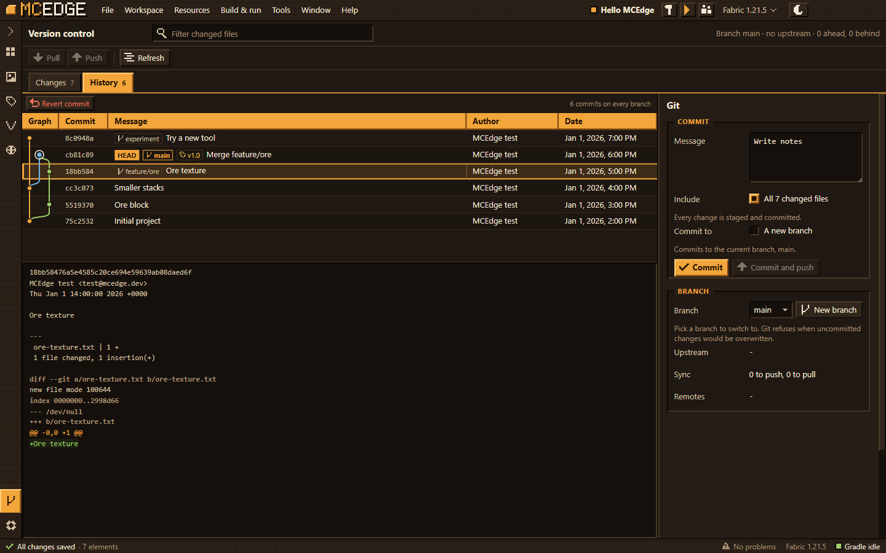
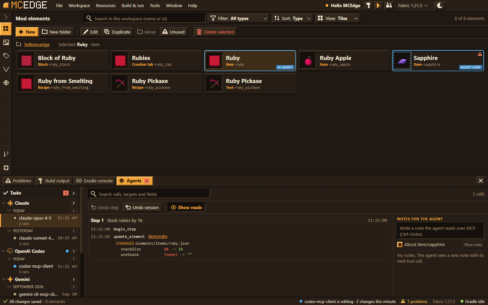

# MCEdge

[English](README.md) | [Türkçe](README.tr.md) | [Deutsch](README.de.md) | [Español](README.es.md) | **简体中文**

MCEdge 是一款桌面编辑器，无需编写 Java 即可制作 Minecraft 模组，定位与 MCreator 相近。你用元素（物品、方块、工具、
界面、实体、配方等）和积木式的过程（procedure）来描述模组，MCEdge 会为五个游戏版本和加载器（Forge、NeoForge、
Fabric）生成并构建同一个模组。项目就是一个普通的 JSON 文件和贴图文件夹，便于用 Git 管理；AI 编程代理也可以通过内置的
MCP 服务器实时读取和编辑项目。

## 截图

| | |
| --- | --- |
|  |  |
| 过程由积木搭建，并为每个引擎编译成 Java。 | 像素贴图编辑器，支持形状、镜像绘制、预览和动画帧。 |
|  |  |
| 用于 GUI 和 HUD 覆盖层（overlay）的可视化布局编辑器。 | 方块贴图显示在 3D 立方体上：点击某一面即可选择它的贴图。 |
|  |  |
| 带分支图的版本控制：提交、分支、拉取和推送。 | 元素列表和代理面板：逐步显示每个 AI 代理改了什么，并可撤销。 |

## 功能

**模组元素**

- 37 种元素类型：物品、方块、工具、盔甲、配方、创造模式标签页、战利品表、界面、覆盖层、过程、命令、生物实体、弹射物、
  流体、植物、附魔、药水效果、粒子、画、生物群系、结构、维度、村民职业与交易、游戏规则、按键绑定、进度等。
- 带说明文字、实时预览和逐字段校验的表单；带严重级别和忽略规则的问题面板。
- 文件夹、搜索、筛选、查找引用、重命名并更新所有引用、查找未使用的元素、模板，以及 "Create pack"（用一个名称和颜色
  生成矿石、工具、盔甲、木材或材料套装）。
- 元素标签（tag）、全局变量和声音事件。

**过程**

- 基于 Blockly 的编辑器，约 430 个积木，按类别分组（流程、逻辑、数学、世界、实体、玩家、物品、效果、粒子、声音、
  界面与客户端、AI 目标等）。
- 全局触发器（游戏事件）、自动生成数据包的客户端与服务端、返回值和局部变量。
- 过程生成的 Java 代码显示在积木旁边。

**资源**

- 贴图编辑器：铅笔、填充、形状、选区、镜像绘制、色相与去色、画布尺寸、动画帧（`.mcmeta`），以及在物品栏格子中和平铺的
  实时预览。
- 方块和物品模型的 3D 预览；立方体上的方块各面；JSON 模型可与 Blockbench 联动编辑。
- GUI 和覆盖层布局编辑器，支持图层、网格吸附、对齐和预览。
- 导入贴图、声音、模型和结构。

**构建与运行**

- 一个项目，五个引擎（见下文）。每个引擎的 JDK 和 Gradle 在首次使用时下载。
- 构建单个或全部引擎，运行客户端和专用服务器，用不同玩家名启动多个客户端测试多人游戏，调试客户端。
- 生成代码中的编译错误会指回导致它的元素。
- 为所选引擎导出模组 jar；将整个工作区导出为 zip。
- 来自 Modrinth、CurseForge 或 Maven 的模组依赖会在测试运行时下载。
- 锁定生成的代码：对元素生成的 Java 所做的手工修改在重新生成时保留。

**项目工具**

- 本地化界面：所有语言并排显示，缺失文本，CSV 和 lang JSON 的导入导出。
- 版本控制：更改、提交、分支、带分支图的历史、还原、拉取和推送（使用你电脑上的 Git）。
- 代码项目模式：打开普通的 Gradle 模组，在 Monaco 编辑器中编辑其文件。
- 界面语言为英语和土耳其语，提供深色和浅色主题。

**AI 代理（MCP）**

- 一个拥有 144 个工具的 Model Context Protocol 服务器，覆盖应用的各项功能：元素、过程、贴图、界面布局、本地化、标签、
  构建、客户端和服务器运行、日志、游戏窗口截图、Git。
- 实时协同编辑：你和代理可以同时编辑同一个项目；已打开的编辑器会逐字段合并代理的更改。
- 代理面板按代理（Claude、Codex、Gemini 等）列出会话，用字段级差异显示每一步，并可撤销一步或整个会话。你还可以在应用
  中给代理留下备注和任务。

## 支持的引擎

| 引擎 | 加载器 | Minecraft | 模组 Java | Gradle（运行所用 JDK） |
| --- | --- | --- | --- | --- |
| `forge-1.16.5` | Forge 36.2.39 | 1.16.5 | 8 | 7.6.4 (JDK 8) |
| `neoforge-1.21.5` | NeoForge 21.5.101 | 1.21.5 | 21 | 9.8.2 (JDK 25) |
| `neoforge-26.3` | NeoForge 26.3.0.99 | 26.3 | 25 | 9.8.2 (JDK 25) |
| `fabric-1.21.5` | Fabric Loader 0.20.1, Fabric API 0.128.2 | 1.21.5 | 21 | 9.8.2 (JDK 25) |
| `fabric-26.3` | Fabric Loader 0.20.1, Fabric API 0.165.0 | 26.3 | 25 | 9.8.2 (JDK 25) |

引擎定义在 [`engines/`](engines) 中。如果某个引擎无法生成某个字段、积木或触发器，应用会明确提示（元素列表可以筛选出某个
引擎不生成的元素）。

## 下载与安装

MCEdge 运行于 Windows（x64）。请从 [GitHub Releases](https://github.com/SalihEfeTosunBayraktar/MCEdge/releases)
下载：

- `MCEdge-Setup-<版本>.exe`：为当前用户安装 MCEdge（可选择安装目录），并通过 GitHub Releases 自动更新。
- `MCEdge-Portable-<版本>.exe`：免安装运行。它不会自动更新，但会在有新版本时提示你。

某个引擎第一次构建或运行时，会把它的 JDK（来自 Adoptium 的 Eclipse Temurin）和 Gradle 下载到
`%APPDATA%\MCEdge\toolchains`，随后 Gradle 会下载 Minecraft 和加载器。每个引擎只需一次，耗时几分钟，并需要联网。
版本控制功能需要 `PATH` 中有 [Git](https://git-scm.com/)。

## 快速上手

1. 启动 MCEdge，选择 **File > Open example project**（Hello MCEdge：红宝石物品、方块、镐、配方和一个创造模式标签页），
   或 **File > New project...**。
2. 双击元素进行编辑，或点击 **New** 新建元素。
3. 在右上角选择一个引擎，然后点击 **Build & run > Run client**（F5）启动带有你的模组的 Minecraft。
4. **File > Export mod jar...**（Ctrl+E）会为你选择的引擎导出 jar。

使用指南可从 **Help > User guide...** 打开（[docs/guide/en](docs/guide/en)，提供英语和土耳其语）。

## 通过 MCP 连接 AI 代理

MCP 服务器针对单个项目文件夹工作，通过 stdio 通信，由你的 AI 客户端启动。它随安装好的应用一起提供，代理所在的电脑
无需 Node.js 或源码：客户端以 Node 方式（`ELECTRON_RUN_AS_NODE=1`）运行 `MCEdge.exe` 并加载应用内置的服务器，不会
打开窗口。**Help > Connect an AI agent**（代理面板中的 *Connect an agent* 也可以）会根据你的安装位置和当前打开的项目
给出完整命令，并提供可直接复制的 Claude Code、Codex、Gemini CLI、Cursor 等客户端配置。

默认的按用户安装下，Claude Code 的命令：

```
claude mcp add --transport stdio --env ELECTRON_RUN_AS_NODE=1 mcedge -- "C:\Users\you\AppData\Local\Programs\MCEdge\MCEdge.exe" "C:\Users\you\AppData\Local\Programs\MCEdge\resources\app.asar\out\cli\index.js" mcp "C:\mods\my-mod"
```

使用 JSON 配置文件的客户端（Gemini CLI `~/.gemini/settings.json`、Cursor `.cursor/mcp.json`、Claude Desktop 等）使用
同样的命令；Codex 则在 `~/.codex/config.toml` 中写成 `[mcp_servers.mcedge]`：

```json
{
  "mcpServers": {
    "mcedge": {
      "command": "C:\\Users\\you\\AppData\\Local\\Programs\\MCEdge\\MCEdge.exe",
      "args": ["C:\\Users\\you\\AppData\\Local\\Programs\\MCEdge\\resources\\app.asar\\out\\cli\\index.js", "mcp", "C:\\mods\\my-mod"],
      "env": { "ELECTRON_RUN_AS_NODE": "1" }
    }
  }
}
```

便携版 exe 无法为代理提供服务（它会解压到关闭时即被删除的临时文件夹）；如需 MCP，请用安装程序安装 MCEdge。

从源码目录运行（见[从源码构建](#从源码构建)；只需 `npm install`）时，同一服务器由 Node.js 运行：

```
node <MCEdge 源码目录>/src/cli.ts mcp <项目文件夹>
claude mcp add mcedge -- node C:/src/MCEdge/src/cli.ts mcp C:/mods/my-mod
```

在 MCEdge 中保持项目打开，即可在代理面板中查看代理的工作过程。所有工具都列在 [docs/MCP.md](docs/MCP.md) 中。普通的
Gradle 模组文件夹同样可用，此时可使用文件、构建、运行和 Git 工具。

## 从源码构建

环境要求：Windows、[Node.js](https://nodejs.org/) 24（核心直接运行 TypeScript 源码）和 Git。

```
git clone https://github.com/SalihEfeTosunBayraktar/MCEdge.git
cd MCEdge
npm install
npm run dev          # 带热重载的应用
npm run build:app    # 构建到 out/；npm start 运行构建好的应用
npm run dist         # 在 release/ 中生成 Windows 安装程序和便携版 exe
npm run typecheck
```

也可以不启动应用，直接用命令行构建项目：

```
node src/cli.ts build examples/hello --target fabric-1.21.5   # 或 --target all；--no-gradle 只生成代码
node src/cli.ts engines
```

## 项目结构

| 路径 | 内容 |
| --- | --- |
| `app/` | Electron 应用：主进程、preload 和 React 界面 |
| `src/` | 核心：项目模型、校验、代码生成器、过程、Gradle 构建与运行、Git、MCP 服务器、CLI |
| `element-types/` | 每种元素类型一个 `type.json`：页面、字段和默认值 |
| `engines/`、`layers/` | 各引擎的设置及其共享的代码模板 |
| `config/` | 过程积木、界面文本（en、tr）、工具链下载地址、原版 id |
| `schemas/` | 项目和引擎的 JSON Schema |
| `examples/hello/` | 内置示例项目 |
| `docs/` | 使用指南、[MCP 参考](docs/MCP.md)、[元素类型格式](docs/ELEMENT-TYPES.md) |
| `tools/` | 界面测试（`ui-test`）、MCP 测试（`mcp-test`）、各引擎生成代码测试（`codegen-test`） |

## 参与贡献

欢迎提交 issue 和 pull request。提交 pull request 前请运行 `npm run typecheck`；对代码生成器的修改应能在所有引擎上构建
通过（`tools/codegen-test`），界面修改可使用 `tools/ui-test` 中驱动真实应用的脚本。代码、注释和提交信息使用英语。

## 许可证

MCEdge 是自由软件，依据 GNU 通用公共许可证第 3 版或（由你选择）任何更高版本（GPL-3.0-or-later）发布。详见
[LICENSE](LICENSE)。

你用 MCEdge 制作的模组归你所有。与 MCreator 一样，MCEdge 为你的模组生成的代码不受 MCEdge 许可证约束；模组的许可证由你在
Workspace settings 中自行选择。
